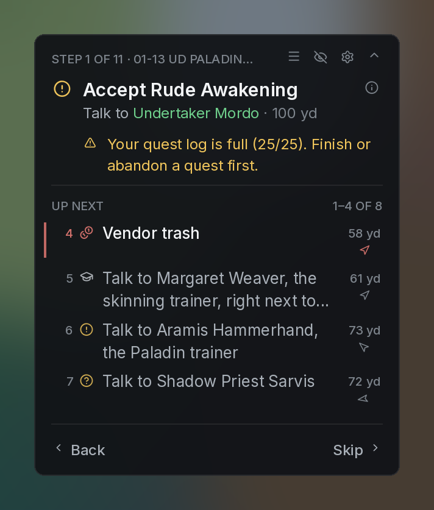
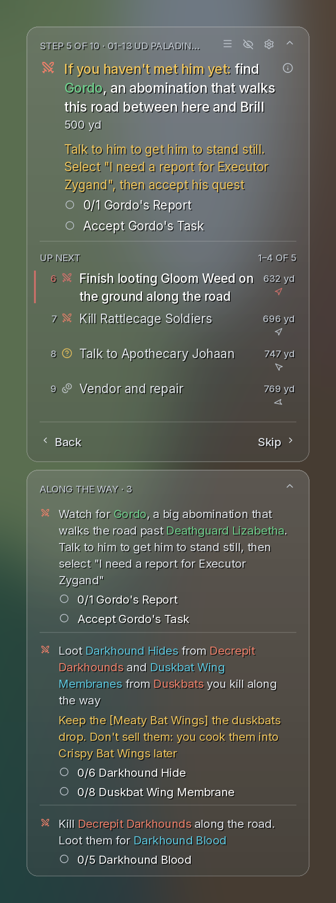
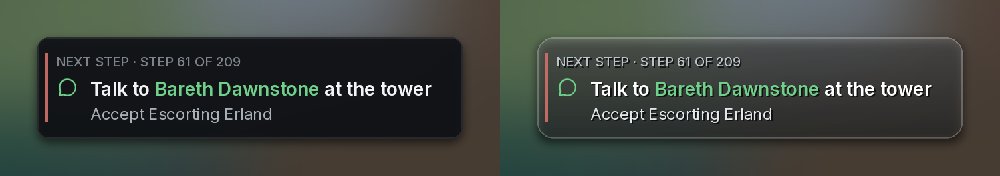
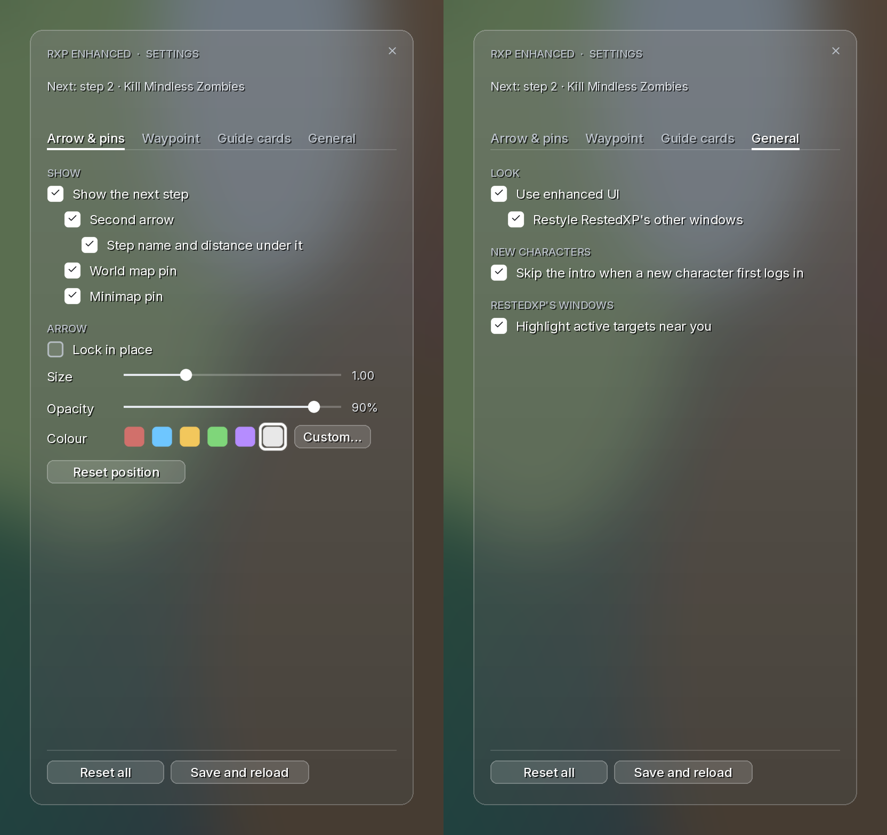

# RXP Enhanced

A companion addon for [RestedXP](https://www.restedxp.com/) guides on **World of Warcraft: Forever** (beta, interface 16001). It adds clean guide cards, an in-world waypoint marker, a second arrow and map pins for the step after yours, step toasts, a matching look for RestedXP's other windows, and it skips the new-character intro.

RestedXP still runs the guide. RXP Enhanced reads it and shows it differently.

<p>
  
  
</p>

## Features

- **Guide card.** Shows the step you're on: the next thing to do with an icon, who to talk to and how far, warnings (full quest log, missing turn-in), and the step's other lines, which you can tick off.
  - **Up next:** the coming steps RestedXP won't skip, each with its distance and a small arrow pointing the way. Scroll up past the current step to see earlier steps: done ones in green with a tick, skipped ones in grey. Shift-click a row to jump to that step.
  - **Back and Skip buttons**, plus notices like "Skipped step 9: you already have Fresh Meat" or "You picked up X; the guide gets to it at step N".
  - **Two looks:** Dark or Glass.
- **Along-the-way card.** Every open `#completewith` step, plus RestedXP's tip. It docks to any side of the main card, or floats free.
- **Waypoint marker.** Sets the game's map waypoint wherever RestedXP's arrow points and draws a marker in the world (Pin, Gold ring or Beacon).
  - When the step's NPC has a nameplate on screen, the marker stands on the NPC.
  - When the spot is off screen, an edge arrow points the way.
  - On arrival, an effect and a sound play.
- **Second arrow and pins.** A tinted second arrow, plus world map and minimap pins, for the step after the one you're on.
- **Step toasts.** When RestedXP moves to the next step or you reach a waypoint, a small card rises into view showing the step. It stays about three seconds, then fades. You can move it wherever you like.
- **RestedXP's other windows restyled.** Active items, Active targets and Level splits get the card look. An Active targets button gets a pulsing green ring when its NPC is near you.
- **No new-character intro.** On a new character's first login, the opening cinematic is skipped for you (no more Escape, then Yes). It only applies to a level 1 character's first minutes in the world, so later cinematics still play.



## Install

1. Install [RestedXP Guides](https://www.restedxp.com/) (`RXPGuides`). RXP Enhanced depends on it.
2. Copy the `RXPEnhanced` folder into `World of Warcraft\_classic_beta_\Interface\AddOns\`. The folder name must stay `RXPEnhanced`.
3. Restart WoW completely. A `/reload` doesn't pick up new addon files.

## Settings

Type `/rxpe` to open the settings window. With **Use enhanced UI** on (the default), it's drawn in the same look as your guide cards (Dark or Glass) and changes with it. The same settings are also under Options > AddOns > RXP Enhanced, in Blizzard's look. There are four tabs:

- **Arrow & pins:** the second arrow, its label, map and minimap pins, size, opacity and colour.
- **Waypoint:** the marker and its style, size and colour, the arrive distance, sounds, quest navigation, standing on the NPC, and the toast (Move toast, Preview, Reset position).
- **Guide cards:** Use enhanced UI, hiding RestedXP's own window, the along-the-way card and its docking, the number of Up next rows, text size, width, look and name colours.
- **General:** Use enhanced UI and the restyle of RestedXP's other windows, skipping the new-character intro, and the Active targets highlight.

**Use enhanced UI** is the master switch for the new look: the guide cards, the settings window in the cards' look, and RestedXP's other windows restyled. Turn it off and RestedXP's own window comes back, and everything is in RestedXP's and Blizzard's own look. The second arrow, map pins, waypoint marker and toast keep their own switches.

At the bottom, **Reset all** puts every setting back to its default, and **Save and reload** reloads the interface (WoW writes addon settings to disk when it reloads or you log out).



### Commands

| Command | What it does |
| --- | --- |
| `/rxpe` | Open settings |
| `/rxpe on` / `off` / `toggle` | Turn the next-step arrow and pins on or off |
| `/rxpe ui` | Turn the enhanced UI on or off (`/rxpe card` works too) |
| `/rxpe rxp` | Show or hide RestedXP's own window |
| `/rxpe waypoint` | Turn the waypoint marker on or off |
| `/rxpe marker pin\|ring\|beacon` | Choose the marker |
| `/rxpe sound on\|off\|glass\|azerite\|crystal\|chime\|ping` | Waypoint sounds |
| `/rxpe toast` | Turn toasts on or off |
| `/rxpe toast move\|test\|reset` | Place the toast, show a sample, or reset its position |
| `/rxpe intro` | Turn skipping the new-character intro on or off |
| `/rxpe skin` | Turn the restyle of RestedXP's other windows on or off |
| `/rxpe arrow` / `label` / `pins` | Second arrow, its label, map pins |
| `/rxpe lock` / `unlock` | Lock the second arrow in place |
| `/rxpe scale <0.4–2.5>` / `opacity <20–100>` / `color <hex>` | Second arrow size, opacity and colour |
| `/rxpe status` / `debug` | What it's doing right now |
| `/rxpe reset` | Reset everything |

## Notes

- Built for the Forever beta client, interface 16001, which uses the modern (Midnight-era) API. It isn't tested on other clients.
- The waypoint marker turns on the game's In-Game Navigation option while it's active (the game needs that option to place the marker), and turns it back off afterwards if it was off before.
- Settings are saved in `RXPEnhancedDB`.

## Development

The `test` folder has offline Lua 5.1 checks that run the addon against a mock of the WoW API and RestedXP:

```sh
cd test
lua5.1 test.lua           # second arrow, pins, settings
lua5.1 test_card.lua      # cards, earlier steps, skins, toasts
lua5.1 test_waypoint.lua  # waypoint marker, arrival, super-tracking
```

`lua5.1 test_card.lua <dir>` and `lua5.1 test_waypoint.lua <dir>` also write layout dumps (cards, toasts, the settings window) that `tools/render_card.py` turns into PNG previews. The `tools` folder has the scripts that build the textures in `Media`.

## Credits

- Font: [Inter](https://github.com/rsms/inter), SIL Open Font License 1.1.
- Icons: [Lucide](https://lucide.dev), ISC License.
- The full licence texts are in `RXPEnhanced/Media/LICENSES.txt`. The other art and sounds were made for this addon.

RestedXP is a separate addon by the RestedXP team. RXP Enhanced is an unofficial companion and isn't affiliated with RestedXP or Blizzard Entertainment.
